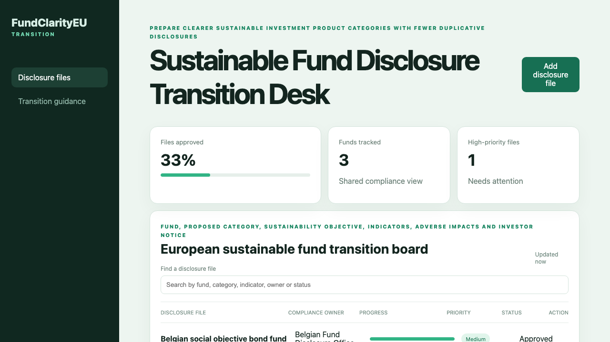

# Sustainable Fund Disclosure Transition Desk

## One-sentence benefit

Map investment products into clearer sustainable-fund categories and streamlined disclosures.

## Live demo

[Watch the workflow](docs/demo.webm).

## Screenshots

## Main features

- Search and sort disclosure files by fund, category, indicator or status.
- Create disclosure files through the Java API.
- Advance work through draft, review and approved states.
- Show loading, empty, error and success feedback.
- Provide operational and guidance routes responsively.

## Technology used

Vue, TypeScript, Pinia, Vue Router, Vite, Spring Boot and Java 21.

## Installation instructions

Install Node.js 22 and Java 21. Run `npm install`, start `cd backend && mvn spring-boot:run`, then run `npm run dev`.

## Commercial licensing/contact

Commercial licensing and integration support are available through the repository contact options.

## Business problem and users

Fund managers and compliance teams need simpler disclosures that remain comparable and understandable for investors.

## Key workflows

Find a fund, add a disclosure file, assess category evidence, advance approval and confirm the API result.

## Vue framework highlights

Pinia manages derived operational state, Vue Router provides multiple views and reactive actions perform real API writes.

## Java backend highlights

Spring Boot exposes validated list, search, create and update APIs, clear errors, health status and service tests.

## Architecture and state flow

Vue calls `/api/items`; Java validates requests and returns records that Pinia shares across routed views.

## Accessibility and responsive behaviour

Semantic controls, labelled search, visible focus styles and responsive tables support keyboard and small screens.

## Verification commands

Run `npm test`, `npm run build`, `cd backend && mvn test` and `cd backend && mvn package`.

## Structure

`src` contains the frontend, `backend` contains Java and `docs` contains inspected media.

## Tradeoffs

In-memory records simplify local use; production needs protected access, persistence and fund-data integrations.

## Roadmap

Add product-category rules, indicator mappings, adverse-impact evidence, investor notices and versioned approvals.
